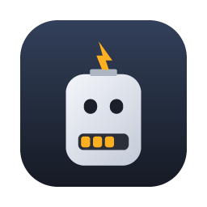
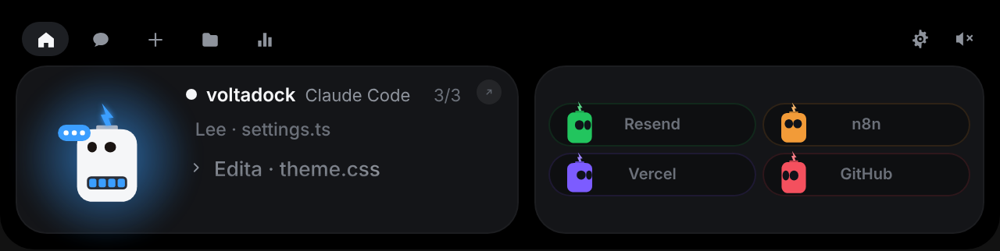
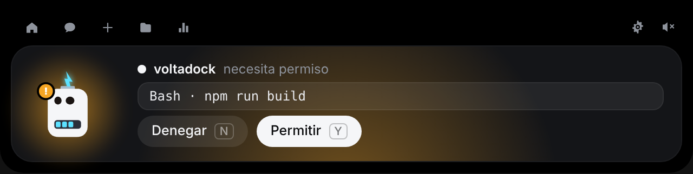
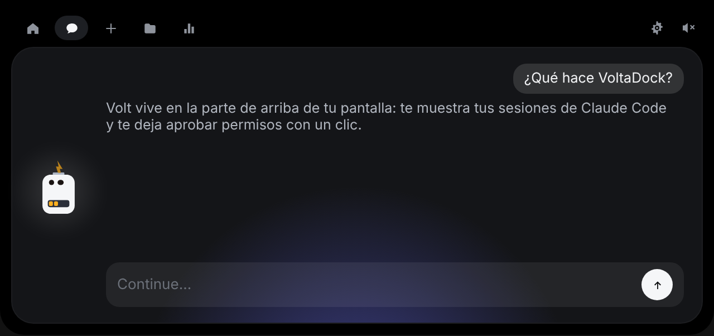
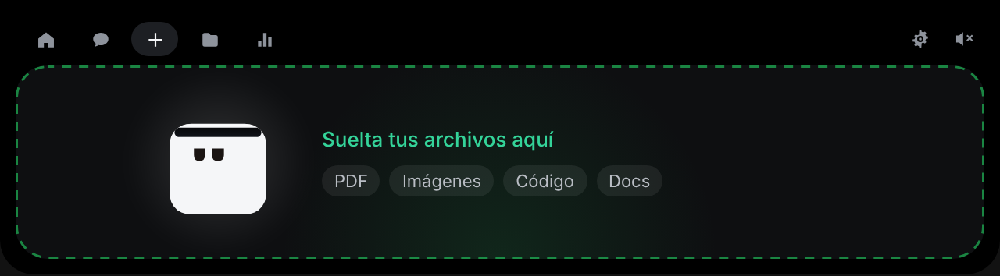

<div align="center">



# VoltaDock

[English](README.en.md) · **Español**

**Un pequeño compañero que vive en el notch de tu MacBook (o en la parte de arriba de la pantalla en Windows) y vigila tus sesiones de Claude Code.**

Aprueba permisos, mira a tus agentes trabajar, suelta un archivo, chatea con Claude… sin dejar lo que estás haciendo.


<sub>Grabación de la versión de Windows con datos de ejemplo.</sub>

</div>

---

## Por qué

Algunos estudios presumieron compañeros para el notch preciosos… y nunca dejaron que nadie los usara.
**VoltaDock es uno abierto.** Cada línea de código se puede usar, leer, bifurcar y remezclar.

Te presento a **Volt**: una pila con antena de rayo que sale del notch, te saluda, sigue tu cursor con los ojos, se enoja cuando le picas (y se marea si insistes). Su barra de carga muestra cómo va Claude Code, y su rayo chispea en cuanto Claude te necesita.

## Funciones

- 🤖 **Claude Code en vivo**: ve cada sesión en la isla, qué lee, qué edita y qué ejecuta, paso a paso. ¿Terminó? Volt da un saltito de alegría.
- ✅ **Aprueba desde la isla**: las solicitudes de permiso de Claude Code llegan con **Denegar / Permitir**. Un clic y de vuelta al trabajo.
- 🧑‍💻 **Salta a la terminal correcta**: abre la ventana exacta de una sesión *(macOS)*.
- 💬 **Pregúntale lo que sea a Claude**: chat integrado, directo desde la isla.
- 📎 **Suelta un archivo en la isla**: Volt se convierte en caja y se lo traga; luego pregunta sobre él o envíalo por correo *(correo: macOS, Mail.app)*.
- 🪟 **Arrastra a Volt sobre cualquier ventana**: la adjunta como contexto para Claude *(macOS)*.
- ⏱️ **Hoy**: un temporizador de enfoque de 25 minutos con cuenta regresiva bajo la isla, pendientes rápidos y recordatorios escritos como hablas (“en 10 min estirarme”, “mañana a las 9 dentista”, “a las 17:30 gym”). Los recordatorios que vencieron mientras la computadora dormía aparecen al despertar. Todo se queda en tu máquina. Activa la pastilla **Hoy** en Ajustes.
- 🔌 **Integraciones**: pagos de Stripe, flujos de n8n, GitHub, despliegues de Vercel, correos de Resend, Notion, Cal.com. Cada una tiene su propio mini Volt de color.
- 📱 **Compañero para iPad** *(en desarrollo)*: ver y aprobar desde un iPad en la misma red Wi-Fi.
- 🎭 **Un personaje de verdad**: respira, parpadea, sus ojos siguen al mouse, tiene emociones, 28 sonidos y un saludo al arrancar.
- 🫥 **Invisible cuando no pasa nada**: se esconde cuando nada está corriendo y se asoma cuando pasas el mouse por el notch (el borde superior de la pantalla en Windows).
- 🔒 **Privado por diseño**: sin telemetría, sin cuenta. Las claves viven en el Llavero de macOS o en el Administrador de credenciales de Windows. La app solo habla con los servicios que tú conectas.

<table>
<tr>
<td></td>
<td></td>
</tr>
<tr>
<td></td>
<td></td>
</tr>
</table>

<sub>Capturas reales de la versión de Windows con datos de ejemplo. Las de Mac llegarán pronto.</sub>

## Instalar

### Descargar para macOS

1. Descarga el último `VoltaDock.zip` desde [Releases](https://github.com/DiegoVolta91/VoltaDock/releases).
2. Descomprímelo y mueve **VoltaDock.app** a `/Aplicaciones`.
3. Ábrela. Esta versión todavía no está notarizada por Apple, así que la primera vez macOS dice que no puede verificar al desarrollador: abre **Ajustes del Sistema → Privacidad y seguridad**, baja y haz clic en **Abrir de todos modos** (solo una vez).

### Windows

El instalador de Windows **no está disponible por ahora**. Microsoft Defender marca
por error el instalador sin firmar como malware; hay un reporte de falso positivo en
revisión en Microsoft y el instalador volverá en cuanto quede resuelto y firmado.
Mientras tanto puedes [compilarlo desde el código](#compilar-desde-el-código).

#### Política de firma de código

Firma de código gratuita proporcionada por [SignPath.io](https://signpath.io), certificado de
[SignPath Foundation](https://signpath.org). Solo se firman los instaladores que compila
GitHub Actions a partir de este repositorio, cada uno aprobado a mano. Roles y
detalles: [política de firma de código](https://diegovolta91.github.io/VoltaDock/code-signing.html).

En una PC no hay notch, así que la isla sale del borde superior de la pantalla en vez
de esconderse dentro de uno. Las demás diferencias están en [`windows/README.md`](windows/README.md).

### Compilar desde el código

**macOS**: necesitas macOS 15+, Xcode 16+ y [XcodeGen](https://github.com/yonaskolb/XcodeGen).

```bash
brew install xcodegen
git clone https://github.com/DiegoVolta91/VoltaDock.git
cd VoltaDock/NotchBuddy
xcodegen
open NotchBuddy.xcodeproj   # luego ⌘R
```

**Windows**: necesitas [Rust](https://rustup.rs), Node 20+ y las herramientas de compilación de MSVC.

```powershell
git clone https://github.com/DiegoVolta91/VoltaDock.git
cd VoltaDock/windows
npm install
npm run pack                # el instalador queda en windows/release/
```

## Configuración

Haz clic en el ícono de VoltaDock en la barra de menús (macOS) o en la bandeja del sistema (Windows) → **Ajustes…**

| Qué | Para qué | Dónde va la clave |
|---|---|---|
| **Hooks de Claude Code** | sesiones en vivo y aprobaciones | **Instalar hooks**: VoltaDock respalda `~/.claude/settings.json`, combina sus hooks y te muestra el diff antes de escribir nada |
| **Clave de API de Anthropic** | chat y preguntas sobre archivos | Llavero / Administrador de credenciales de Windows |
| Stripe, n8n, GitHub, Vercel, Resend, Notion, Cal.com | las pastillas de integraciones | Llavero / Administrador de credenciales de Windows, todas opcionales |

Si VoltaDock no está abierta, el hook termina al instante: **Claude Code nunca se queda bloqueado.**

## Cosas para probar

| Haz esto | Volt hace esto |
|---|---|
| Pasa el mouse por el notch (borde superior en Windows) | se asoma y saluda 👋 |
| Haz clic | se abre |
| Pasa el mouse sobre Volt | parpadea, los ojos crecen |
| Haz clic en Volt | se aplasta y se enoja |
| Tres clics rápidos | 😵‍💫 mareado unos segundos |
| Arrastra un archivo a la isla | se convierte en caja y se lo traga |
| Arrastra a Volt sobre una ventana *(macOS)* | la adjunta como contexto |

## Cómo funciona

**macOS**

- **Isla**: un `NSPanel` sin bordes pegado al notch, manejado por una pequeña máquina de estados (`hidden → petit → home`).
- **Personaje**: Volt se dibuja con `Canvas` + `TimelineView` de SwiftUI a 60 fps (`VoltShape.swift`): cuerpo de pila, antena de rayo, barra de carga, ojos que siguen al cursor, animaciones con resorte. Sin Rive, sin Lottie, sin imágenes.
- **Claude Code**: un pequeño script `nb-hook` recibe los eventos de los hooks y los reenvía a la app por un socket Unix. Para las aprobaciones espera tu clic y luego responde al hook.
- **Integraciones**: consultas ligeras que se pausan cuando nadie está mirando.
- **Sonidos**: 28 WAV cortos, sintetizados en código y reproducidos con `AVAudioPlayer` precargados.

La app de macOS es Swift 6 / SwiftUI / AppKit nativo, **sin dependencias de terceros**.

**Windows**

- Una app [Tauri 2](https://tauri.app) (Rust + TypeScript): la isla es una ventana transparente, siempre encima, que nunca roba el foco. Volt se dibuja en Canvas 2D con las mismas formas, tiempos y sonidos que en la Mac.
- Los hooks de Claude Code pasan por un pequeño ejecutable intermediario (`voltadock-hook.exe`) y una tubería con nombre; las claves viven en el Administrador de credenciales de Windows.
- Detalles y diferencias en [`windows/README.md`](windows/README.md).

## Contribuir

Los issues y PRs son muy bienvenidos: nuevas integraciones, nuevas emociones, nuevos sonidos, correcciones. Lee [CONTRIBUTING.md](CONTRIBUTING.md).

## Créditos

Hecho por Diego ([@DiegoVolta91](https://github.com/DiegoVolta91)) con Claude Code.
VoltaDock empezó como un fork de Coucou, de Louis Raillé (MIT), y ahora se desarrolla de forma independiente; el aviso de copyright original se conserva en [LICENSE](LICENSE).
Inspirado en los conceptos de compañeros para el notch que han compartido estudios de diseño. Este proyecto es independiente y no está afiliado a ninguno de ellos.

## Licencia

- **Código:** [MIT](LICENSE). Úsalo, bifúrcalo, aprende de él; solo conserva el aviso de copyright.
- **Personaje, íconos y sonidos:** Volt, los íconos de la app y los sonidos son de VoltaDock, dibujados y sintetizados en código (MIT).
- **Capturas y demo** en `docs/media/`: capturas de VoltaDock (MIT). Las referencias de diseño en `design/` todavía vienen del proyecto original y no están cubiertas por la licencia MIT; ver [LICENSE-ASSETS.md](LICENSE-ASSETS.md).

<div align="center">

**Si Volt te sacó una sonrisa, una ⭐ ayuda muchísimo.**

[Sitio web](https://diegovolta91.github.io/VoltaDock/) · [Privacidad](https://diegovolta91.github.io/VoltaDock/privacy.html) · [Términos](https://diegovolta91.github.io/VoltaDock/terms.html) · [Ayuda](https://diegovolta91.github.io/VoltaDock/support.html) · [Política de firma de código](https://diegovolta91.github.io/VoltaDock/code-signing.html)

</div>
