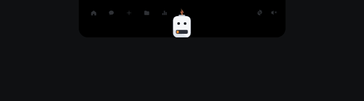

<div align="center">


# VoltaDock

**A tiny friend that lives in your MacBook's notch — or at the top of your screen on Windows — and keeps an eye on your Claude Code sessions.**

Approve permissions, watch your agents work, drop a file, chat with Claude — all without leaving what you're doing.




</div>

---

## Why

Some studios showed off gorgeous notch companions… and never let anyone use them.
**VoltaDock is an open one.** Every line of code is free to use, read, fork and remix.

Meet **Volt**: a little battery with a lightning-bolt antenna that pops out of your notch, waves hello, follows your cursor with its eyes, gets annoyed when you poke it (and dizzy if you insist). Its charge bar shows how Claude Code is doing, and its bolt sparks the moment Claude needs you.

## Features

- 🤖 **Claude Code, live** — see every session in your notch: what it reads, edits and runs, step by step. Finished? Mochi does a happy little jump.
- ✅ **Approve from the notch** — Claude Code permission requests show up with **Allow / Deny**. One click, back to work.
- 🧑‍💻 **Jump to the right terminal** — open the exact terminal window of a session *(macOS)*.
- 💬 **Ask Claude anything** — built-in chat, straight from the notch.
- 📎 **Drop a file on the notch** — Mochi turns into a box and swallows it, then ask a question about it or send it by email *(email: macOS, Mail.app)*.
- 🪟 **Drag Mochi onto any window** — attach that window as context for Claude *(macOS)*.
- ⏱️ **Today** — a 25-minute focus timer with its countdown under the island, quick to-dos and reminders typed in plain words (“in 10 min stretch”, “tomorrow at 9 dentist”, “a las 17:30 gym”). Reminders that came due while the computer slept show up when it wakes. Everything stays on your machine. Turn the **Today** pill on in Settings.
- 🔌 **Integrations** — Stripe payments, n8n workflows, GitHub, Vercel deployments, Resend emails, Notion, Cal.com. Each one gets its own little colored Mochi.
- 🎭 **A real character** — idle breathing, blinks, eyes on a sphere that follow your mouse, emotes, 28 handcrafted sounds, a greeting on launch.
- 🫥 **Invisible when idle** — hides away when nothing is running, peeks out when you hover the notch (the top edge of the screen on Windows).
- 🔒 **Private by design** — no telemetry, no account. Keys live in your macOS Keychain or Windows Credential Manager. The app only talks to the services you plug in.

<table>
<tr>
<td></td>
<td></td>
</tr>
<tr>
<td></td>
<td></td>
</tr>
</table>

## Install

### Download for macOS

1. Grab the latest `VoltaDock.zip` from [Releases](https://github.com/DiegoVolta91/coucou/releases).
2. Unzip and move **VoltaDock.app** to `/Applications`.
3. Launch. This build isn't notarized by Apple yet, so the first time macOS says it can't verify the developer: open **System Settings → Privacy & Security**, scroll down and click **Open Anyway** (only once).

### Windows

The Windows installer is **temporarily unavailable**. Microsoft Defender wrongly
flags the unsigned installer as malware; a false-positive report is under review
at Microsoft and the installer will come back once it is cleared and signed.
Until then you can [build it from source](#build-from-source).

#### Code signing policy

Free code signing provided by [SignPath.io](https://signpath.io), certificate by
[SignPath Foundation](https://signpath.org). Only installers built by GitHub
Actions from this repository are signed, each one approved by hand. Roles and
details: [code signing policy](https://diegovolta91.github.io/VoltaDock/code-signing.html).

There is no notch on a PC, so the island slides out of the top edge of the screen
instead of hiding inside one. See [`windows/README.md`](windows/README.md) for the
rest of the differences.

### Build from source

**macOS** — requirements: macOS 15+, Xcode 16+, [XcodeGen](https://github.com/yonaskolb/XcodeGen).

```bash
brew install xcodegen
git clone https://github.com/DiegoVolta91/coucou.git
cd coucou/NotchBuddy
xcodegen
open NotchBuddy.xcodeproj   # then ⌘R
```

**Windows** — requirements: [Rust](https://rustup.rs), Node 20+, MSVC build tools.

```powershell
git clone https://github.com/DiegoVolta91/coucou.git
cd coucou/windows
npm install
npm run pack                # installer lands in windows/release/
```

## Setup

Click the VoltaDock icon in the menu bar (macOS) or in the system tray (Windows) → **Settings…**

| What | Why | Where the key goes |
|---|---|---|
| **Claude Code hooks** | live sessions and approvals | **Install hooks** — VoltaDock backs up `~/.claude/settings.json`, merges its hooks and shows you the diff before writing anything |
| **Anthropic API key** | chat and questions about files | Keychain / Windows Credential Manager |
| Stripe, n8n, GitHub, Vercel, Resend, Notion, Cal.com | the integration pills | Keychain / Windows Credential Manager, all optional |

If VoltaDock isn't running, the hook exits immediately: **Claude Code is never blocked.**

## Things to try

| Do this | Mochi does that |
|---|---|
| Hover the notch (top edge on Windows) | peeks out and says hi 👋 |
| Click it | opens |
| Hover Mochi | blinks, eyes grow |
| Click Mochi | squish + annoyed |
| Click 3 times fast | 😵‍💫 dizzy for a few seconds |
| Drag a file onto the island | turns into a box and swallows it |
| Drag Mochi onto a window *(macOS)* | attaches it as context |

## How it works

**macOS**

- **Island**: a borderless `NSPanel` hugging the notch, driven by a small state machine (`hidden → petit → home`).
- **Character**: drawn in SwiftUI `Canvas` + `TimelineView` at 60 fps — squircle body, eyes projected on a sphere, spring animations. No Rive, no Lottie, no images.
- **Claude Code**: a tiny `nb-hook` script receives hook events and forwards them over a Unix socket to the app. For approvals it waits for your click, then answers the hook.
- **Integrations**: lightweight pollers, paused when nothing is watching.
- **Sounds**: 28 short WAVs played through preloaded `AVAudioPlayer`s.

The macOS app is native Swift 6 / SwiftUI / AppKit with **zero third-party dependencies**.

**Windows**

- A [Tauri 2](https://tauri.app) app (Rust + TypeScript): the island is a transparent, always-on-top window that never steals focus, Mochi is drawn in Canvas 2D with the same shapes, timings and sounds as on the Mac.
- Claude Code hooks go through a tiny `coucou-hook.exe` and a named pipe; keys live in Windows Credential Manager.
- Details and differences in [`windows/README.md`](windows/README.md).

## Contributing

Issues and PRs are very welcome — new integrations, new emotes, new sounds, bug fixes. See [CONTRIBUTING.md](CONTRIBUTING.md).

## Credits

Built by Diego ([@DiegoVolta91](https://github.com/DiegoVolta91)) with Claude Code.
VoltaDock started as a fork of [Coucou](https://github.com/Louis-CFM/coucou) by Louis Raillé (MIT) and is now developed independently.
Inspired by the notch-companion concepts shared by design studios — this project is independent and not affiliated with any of them.

## License

- **Code:** [MIT](LICENSE) — use it, fork it, learn from it, just keep the copyright notice.
- **Character, icons and sounds:** Volt, the app icons and the sounds are VoltaDock's own, drawn and synthesised in code (MIT).
- **Screenshots and demo media** in `docs/media/` and `design/` still come from Coucou: © Louis Raillé, not covered by the MIT License — see [LICENSE-ASSETS.md](LICENSE-ASSETS.md). They will be replaced with Volt captures.

<div align="center">

**If Volt made you smile, a ⭐ helps a lot.**

[Website](https://diegovolta91.github.io/VoltaDock/) · [Privacy](https://diegovolta91.github.io/VoltaDock/privacy.html) · [Terms](https://diegovolta91.github.io/VoltaDock/terms.html) · [Support](https://diegovolta91.github.io/VoltaDock/support.html) · [Code signing policy](https://diegovolta91.github.io/VoltaDock/code-signing.html)

</div>
